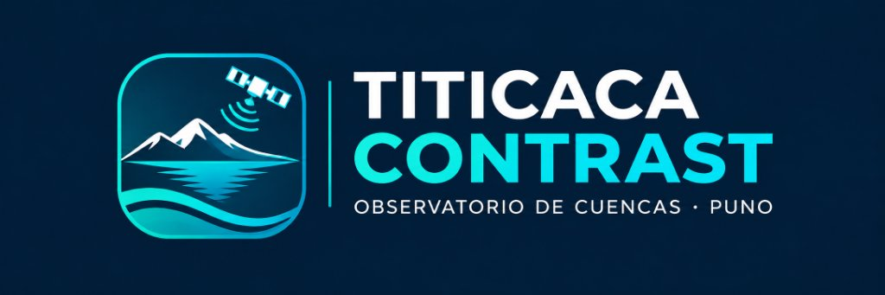
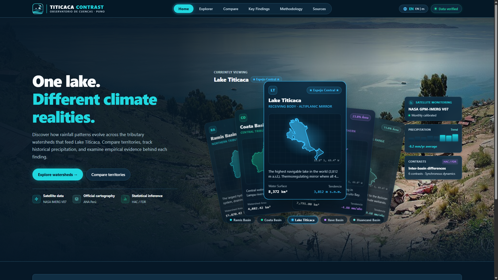

<div align="center">

<p align="right">
  <strong>Language:</strong>
  <a href="README.md">🇪🇸 Español</a> |
  <a href="README_en.md">🇺🇸 English</a>
</p>



# TITICACA CONTRAST

### 🌊 One Lake. Different Climate Realities.

**Geospatial satellite observatory, interactive 3D WebGL visualization, and reproducible climate inference for Lake Titicaca tributary watersheds (Puno, Peru)**

[](https://react.dev/)
[](https://www.typescriptlang.org/)
[](https://threejs.org/)
[](https://vitejs.dev/)
[](https://leafletjs.com/)
[](https://echarts.apache.org/)
[](https://www.python.org/)
[](https://disc.gsfc.nasa.gov/)
[](https://snirh.ana.gob.pe/)
[](https://vitest.dev/)
[](https://pytest.org/)
[](https://owasp.org/)
[](LICENSE)

</div>

---

## 📸 High-Fidelity Interface



---

## ⚡ Project Highlights

| Metric | Verified Value | Technical Description |
| :--- | :--- | :--- |
| **Monitored Watersheds** | **4 official basins** | Ramis (15,870 km²), Coata (4,882 km²), Ilave (7,791 km²), Huancané (3,612 km²) |
| **Satellite Data Source** | **NASA GPM-IMERG V07 Final** | Calibrated monthly L3 product (`GPM_3IMERGM_07`, DOI: 10.5067/GPM/IMERG/3B-MONTH/07) |
| **Official Cartography** | **ANA SNIRH Peru** | Official hydrological boundaries under Pfafstetter standard (Level 4/5) |
| **Validated Period** | **2001 – 2024 (24 years)** | 1,152 monthly watershed observations with area-weighted zonal statistics |
| **Precipitation Trends** | **4 / 4 decreasing** | Non-parametric Theil-Sen coefficients (–4.88 to –11.45 mm/year) |
| **Inter-basin Inference** | **Synchronous Regional Regime** | Newey-West HAC inference (L=2) and Benjamini-Hochberg FDR control ($q > 0.05$) |
| **Web Security** | **Zero-Trust Client** | Strict CSP, anti-clickjacking, no exposed API keys, SHA-256 in manifest |
| **Clean Architecture** | **0 comments in source code** | Pure, modular, and 100% typed with TypeScript and Python |

---

## ✨ Key Features

### 🛰️ 1. NASA GPM IMERG V07 Satellite Monitoring
- Automated ingestion pipeline connecting directly to NASA GES DISC via OPeNDAP across the Lake Titicaca bounding box.
- Transparent processing of 297 officially released months (2001-01 to 2025-09), preserving official product calibration latency without fabricated interpolations.
- Zonal aggregation by exact watershed polygon boundaries.

### 🌐 2. Immersive 3D Geospatial Scene (Three.js WebGL)
- 3D spatial reconstruction of all 4 tributary basins and Lake Titicaca with procedural topographical extrusion and color coding.
- Animated orbital satellite pass with conical scanning beam and dynamic scene lighting.
- Intelligent projected framing algorithm (`fitCameraToScene`) ensuring smooth navigation and native double-click view reset.
- Fully accessible with `prefers-reduced-motion` support and decoupled CSS Grid telemetry panels.

### 🗺️ 3. Official Hydrographic Explorer (Leaflet + OpenStreetMap)
- Interactive mapping powered by secure HTTPS OpenStreetMap tile servers with zero API key dependencies or watermarks.
- Official ANA Peru polygon geometries verified for zero inter-basin overlap.
- Institutional tooltips displaying official watershed names, Pfafstetter codes, and calculated surface areas in km².

### 📊 4. Econometric Gap Engine & Reproducible Evidence Sheets
- Robust time-gap slope estimation:
  $$\Delta \text{Trend} = \frac{d}{dt} \left[ P_A(t) - P_B(t) \right]$$
- Heteroskedasticity and Autocorrelation Consistent (HAC / Newey-West) standard errors ($L=2$).
- Multi-lag sensitivity checks ($L=1, 2, 3$) and serial autocorrelation lag-1 calculation ($r$).
- Multiplicity control using the Benjamini-Hochberg procedure ($m=6, q \le 0.05$).
- Modal evidence sheets with explicit non-causality notices and direct CSV export.

### 🔒 5. Zero-Trust Security Hardening (NASA / OWASP Standard)
- Strict **Content Security Policy (CSP)** in metadata and production HTTP headers:
  - `default-src 'self'`
  - `script-src 'self' 'unsafe-inline' 'wasm-unsafe-eval'`
  - `style-src 'self' 'unsafe-inline'`
  - `img-src 'self' data: blob: https:`
  - `connect-src 'self' data: blob: https:`
  - `object-src 'none'`
  - `base-uri 'self'`
- Defensive security headers: `X-Content-Type-Options: nosniff`, `X-Frame-Options: DENY`, `Referrer-Policy: strict-origin-when-cross-origin`, `Permissions-Policy`.
- Zero client-side API keys or secrets; **SHA-256** cryptographic hashes verifiable in `manifest.json`.

---

## 🔬 Scientific Findings Summary

Empirical analysis across 24 complete observation years (2001–2024) reveals:

1. **Shared regional trajectory:** All tributary basins around Lake Titicaca exhibit negative annual precipitation trends (Ramis: –11.45 mm/year, Huancané: –10.68 mm/year, Coata: –8.13 mm/year, Ilave: –4.88 mm/year).
2. **Synchronous regional dynamics:** None of the 6 paired inter-basin contrasts demonstrate anomalous divergence after FDR multiplicity correction ($q > 0.05$). The hydrological network responds synchronously to shared Andean climate drivers.
3. **Moderate local variability:** The Coata ↔ Ilave pair exhibits a nominal slope of –2.07 mm/year ($p = 0.0443$), which under Benjamini-Hochberg FDR control ($q = 0.2659$) is properly categorized as microclimatic fluctuation within the shared regional regime.

---

## 🚀 Quickstart

### Prerequisites
- **Node.js** v20 LTS or higher and **npm**
- **Python** 3.11 or higher
- **Git**

### 1. Clone the repository
```bash
git clone https://github.com/DarioLipa/titicaca-contrast.git
cd titicaca-contrast
```

### 2. Frontend Web App (React + Vite + Three.js)
```bash
cd web
npm install
npm run dev
```
The application will be accessible at `http://localhost:5173/`.

To build the production bundle:
```bash
npm run build
```

### 3. Scientific Data Pipeline (Python)
```bash
cd pipeline
python -m venv .venv

# On Windows:
.\.venv\Scripts\Activate.ps1
# On Linux / macOS:
source .venv/bin/activate

pip install -e .
pytest
```

### 4. Full Quality & Verification Suite
Run the complete automated check (Typecheck + Lint + 16 Vitest + 32 Pytest + Build):
```powershell
powershell -ExecutionPolicy Bypass -File scripts\check-project.ps1
```

---

## 📁 Repository Structure

```
TITICACA-CONTRAST/
├── .github/
│   └── workflows/
│       └── deploy.yml              # Automated GitHub Pages CI/CD workflow
├── docs/
│   ├── assets/                     # Official brand logos and graphics
│   ├── screenshots/                # Multi-device responsive captures
│   ├── arquitectura.md             # System architecture specification
│   ├── auditoria.md                # Quality, security and audit logs
│   ├── metodologia.md              # Mathematical methods, HAC and FDR
│   ├── diccionario-datos.md        # Data schema dictionary
│   ├── fuentes-y-licencias.md      # Institutional provenance and copyright
│   └── plan-maestro.md             # Foundational technical master plan
├── pipeline/
│   ├── src/titicaca_contrast/      # Core Python data engine
│   ├── tests/                      # 32 mathematical & pipeline tests (Pytest)
│   ├── pyproject.toml              # Python package metadata
│   └── requirements-lock.txt       # Locked dependencies for reproducibility
├── web/
│   ├── public/
│   │   ├── _headers                # Static hosting CSP and security headers
│   │   ├── favicon.svg             # Vector favicon
│   │   ├── data/                   # Analytical datasets and manifest.json
│   │   └── images/                 # Lake Titicaca background panorama
│   ├── src/
│   │   ├── app/                    # Zod schemas and reactive data loaders
│   │   ├── components/             # 3D WebGL, maps, charts and telemetry
│   │   ├── pages/                  # Home, Explorer, Compare, Findings, etc.
│   │   ├── styles/                 # CSS design tokens and global styles
│   │   └── tests/                  # 16 unit & integration tests (Vitest)
│   ├── index.html                  # HTML entry point with CSP meta tags
│   ├── package.json                # npm dependencies and scripts
│   └── vite.config.ts              # Vite configuration with manualChunks
├── scripts/
│   ├── check-project.ps1           # Global quality verification script
│   ├── package-distribution.ps1    # ZIP release packager
│   └── capture-screenshots.ps1     # Responsive screenshot generator
├── LICENSE                         # MIT License
├── README.md                       # Spanish documentation
└── README_en.md                    # English documentation
```

---

## 📚 Citations & Data Sources

- **NASA IMERG V07 Final:** Huffman, G. J., et al. (2024). *GPM IMERG Final Precipitation L3 1 month 0.1 degree x 0.1 degree V07*, Goddard Earth Sciences Data and Information Services Center (GES DISC), [doi:10.5067/GPM/IMERG/3B-MONTH/07](https://doi.org/10.5067/GPM/IMERG/3B-MONTH/07).
- **Official Watershed Cartography:** National Water Authority (ANA), Ministry of Agrarian Development and Irrigation of Peru. National Water Resources Information System ([SNIRH](https://snirh.ana.gob.pe/)).
- **Background Photography:** *Capachica Peninsula / Lake Titicaca*, photograph by Martin St-Amant ([CC-BY-SA 3.0](https://creativecommons.org/licenses/by-sa/3.0/)).

---

## 📄 License

This project is licensed under the **MIT License** — see the [LICENSE](LICENSE) file for details.

---

<div align="center">

© 2026 **DalíPE**. All rights reserved.  
*Academic affiliation:* **UPRIT**

</div>
