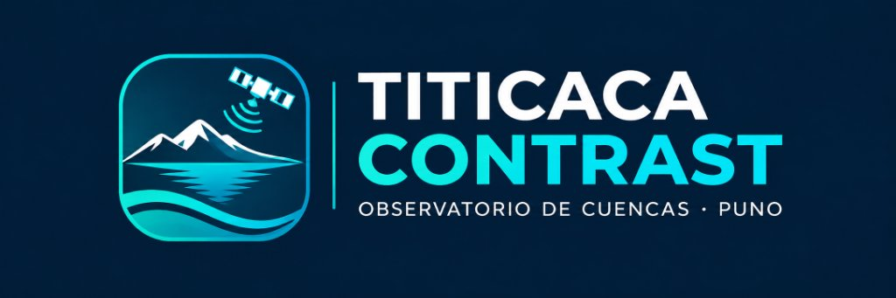
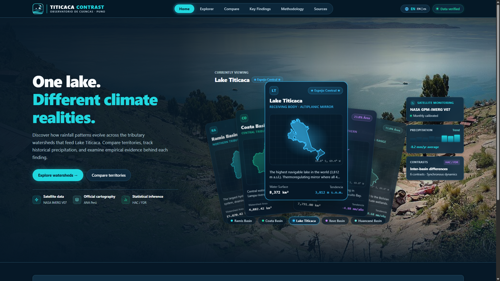

<div align="center">

<p align="right">
  <strong>Idioma / Language:</strong>
  <a href="README.md">🇺🇸 English</a> |
  <a href="README_es.md">🇪🇸 Español</a>
</p>



# TITICACA CONTRAST

### 🌊 Un mismo lago. Diferentes realidades climáticas.

**Observatorio satelital geoespacial, visualización 3D interactiva e inferencia climática reproducible de las cuencas tributarias del Lago Titicaca (Puno, Perú)**

[](https://react.dev/)
[](https://www.typescriptlang.org/)
[](https://threejs.org/)
[](https://vitejs.dev/)
[](https://leafletjs.com/)
[](https://echarts.apache.org/)
[](https://www.python.org/)
[](https://disc.gsfc.nasa.gov/)
[](https://snirh.ana.gob.pe/)
[](https://vitest.dev/)
[](https://pytest.org/)
[](https://owasp.org/)
[](LICENSE)

</div>

---

## 📸 Interfaz de Alta Fidelidad



---

## ⚡ Highlights del Proyecto

| Parámetro | Valor Verificado | Descripción Técnica |
| :--- | :--- | :--- |
| **Cuencas Monitoreadas** | **4 cuencas oficiales** | Ramis (15,870 km²), Coata (4,882 km²), Ilave (7,791 km²), Huancané (3,612 km²) |
| **Fuente de Datos Satelital** | **NASA GPM-IMERG V07 Final** | Producto calibrado mensual L3 (`GPM_3IMERGM_07`, DOI: 10.5067/GPM/IMERG/3B-MONTH/07) |
| **Cartografía Oficial** | **ANA SNIRH Perú** | Delimitación hidrográfica oficial bajo metodología Pfafstetter (Nivel 4/5) |
| **Horizonte Validado** | **2001 – 2024 (24 años)** | 1,152 observaciones mensuales de cuenca agregadas espacialmente |
| **Tendencias Pluviométricas** | **4 / 4 decrecientes** | Coeficientes no paramétricos Theil-Sen (–4.88 a –11.45 mm/año) |
| **Inferencia Intercuenca** | **Dinámica Regional Sincrónica** | Inferencia Newey-West (HAC L=2) y control FDR Benjamini-Hochberg ($q > 0.05$) |
| **Seguridad Web** | **Zero-Trust Client** | CSP estricto, anti-clickjacking, sin claves expuestas, SHA-256 en manifest |
| **Código Limpio** | **0 comentarios en código** | Arquitectura pura, modular y 100% tipada con TypeScript y Python |

---

## ✨ Características Principales

### 🛰️ 1. Monitoreo Satelital NASA GPM IMERG V07
- Integración automatizada del catálogo oficial NASA GES DISC mediante protocolo OPeNDAP sobre el bounding box del Lago Titicaca.
- Procesamiento exacto de 297 meses publicados oficialmente (2001-01 a 2025-09). Registro transparente de latencia oficial sin imputaciones artificiales.
- Agregación zonal por polígono exacto de cuenca ponderado por área.

### 🌐 2. Escena 3D Geoespacial Inmersiva (Three.js)
- Reconstrucción tridimensional de las 4 cuencas y el Lago Titicaca con extrusión topográfica procedural y paleta cromática diferenciada.
- Satélite orbital animado con haz cónico de escaneo e iluminación dinámica.
- Algoritmo de encuadre proyectado inteligente (`fitCameraToScene`) con navegación suave y reseteo por doble clic.
- Diseño accesible que respeta `prefers-reduced-motion` y desacopla la telemetría en Grid responsive.

### 🗺️ 3. Explorador Cartográfico Hidrográfico (Leaflet + OSM)
- Visualización interactiva sobre teselas protegidas HTTPS de OpenStreetMap sin advertencias ni API keys requeridas.
- Polígonos oficiales de la Autoridad Nacional del Agua con solapamiento nulo verificado topológicamente.
- Tooltips institucionales con nombre oficial, código Pfafstetter ANA y superficie calculada en km².

### 📊 4. Motor Econométrico de Contrastes y Fichas de Evidencia
- Estimación robusta de pendientes de brecha temporal:
  $$\Delta \text{Trend} = \frac{d}{dt} \left[ P_A(t) - P_B(t) \right]$$
- Errores estándar consistentes ante heterocedasticidad y autocorrelación temporal (Newey-West HAC, ventana $L=2$).
- Análisis exhaustivo de sensibilidad ante rezagos alternativos ($L=1, 2, 3$) y cálculo de autocorrelación serial lag-1 ($r$).
- Control riguroso de multiplicidad estadística con el procedimiento Benjamini-Hochberg ($m=6, q \le 0.05$).
- Fichas modales de evidencia con límites de no-causalidad física y descarga directa en CSV.

### 🔒 5. Blindaje de Seguridad y Cero Fugas de Datos
- **Content Security Policy (CSP)** rigurosa en metadatos y cabeceras HTTP de producción:
  - `default-src 'self'`
  - `script-src 'self' 'unsafe-inline' 'wasm-unsafe-eval'`
  - `style-src 'self' 'unsafe-inline'`
  - `img-src 'self' data: blob: https:`
  - `connect-src 'self' data: blob: https:`
  - `object-src 'none'`
  - `base-uri 'self'`
- Cabeceras defensivas: `X-Content-Type-Options: nosniff`, `X-Frame-Options: DENY`, `Referrer-Policy: strict-origin-when-cross-origin`, `Permissions-Policy`.
- Cero claves de API o credenciales en el cliente; hashes criptográficos **SHA-256** documentados en `manifest.json`.

---

## 🔬 Síntesis del Hallazgo Científico

Los datos satelitales analizados durante los 24 años completos (2001–2024) demuestran que:

1. **Tendencia compartida:** Todas las cuencas tributarias del Lago Titicaca experimentan tasas de precipitación anual decrecientes (Ramis: –11.45 mm/año, Huancané: –10.68 mm/año, Coata: –8.13 mm/año, Ilave: –4.88 mm/año).
2. **Dinámica regional sincrónica:** Ninguno de los 6 contrastes emparejados intercuenca evidencia divergencias territoriales desproporcionadas tras control FDR ($q > 0.05$). Esto corrobora que el sistema hidrográfico responde de manera acoplada a un mismo forzamiento climático regional andino.
3. **Variabilidad natural moderada:** El par Coata ↔ Ilave exhibe una fluctuación nominal de –2.07 mm/año ($p = 0.0443$), que al evaluarse bajo control múltiple ($q = 0.2659$) se clasifica honestamente como variación microclimática absorbida dentro de la dinámica compartida.

---

## 🚀 Inicio Rápido (Quickstart)

### Requisitos previos
- **Node.js** v20 LTS o superior y **npm**
- **Python** 3.11 o superior
- **Git**

### 1. Clonar el repositorio
```bash
git clone https://github.com/DarioLipa/titicaca-contrast.git
cd titicaca-contrast
```

### 2. Frontend Web (React + Vite + Three.js)
```bash
cd web
npm install
npm run dev
```
La aplicación estará disponible inmediatamente en `http://localhost:5173/`.

Para compilar el bundle optimizado para producción:
```bash
npm run build
```

### 3. Pipeline Científico (Python)
```bash
cd pipeline
python -m venv .venv

# En Windows:
.\.venv\Scripts\Activate.ps1
# En Linux / macOS:
source .venv/bin/activate

pip install -e .
pytest
```

### 4. Verificación Automatizada Integral
Ejecuta la suite completa de calidad (Typecheck + Lint + 16 Vitest + 32 Pytest + Build):
```powershell
powershell -ExecutionPolicy Bypass -File scripts\check-project.ps1
```

---

## 📁 Estructura del Repositorio

```
TITICACA-CONTRAST/
├── .github/
│   └── workflows/
│       └── deploy.yml              # CI/CD automatizado para GitHub Pages
├── docs/
│   ├── assets/                     # Logotipo oficial e identidad gráfica
│   ├── screenshots/                # Capturas de pantalla multidispositivo
│   ├── arquitectura.md             # Especificación técnica del sistema
│   ├── auditoria.md                # Bitácora de calidad, seguridad y verificaciones
│   ├── metodologia.md              # Métodos matemáticos, HAC y control FDR
│   ├── diccionario-datos.md        # Estructura de esquemas y tipos de datos
│   ├── fuentes-y-licencias.md      # Procedencia institucional y derechos de autor
│   └── plan-maestro.md             # Documento base de planificación técnica
├── pipeline/
│   ├── src/titicaca_contrast/      # Código fuente del motor de datos en Python
│   ├── tests/                      # 32 pruebas científicas y numéricas (Pytest)
│   ├── pyproject.toml              # Configuración del paquete Python
│   └── requirements-lock.txt       # Dependencias fijadas para reproducibilidad
├── web/
│   ├── public/
│   │   ├── _headers                # Cabeceras de seguridad CSP para hosting estático
│   │   ├── favicon.svg             # Favicon vectorial oficial
│   │   ├── data/                   # Datos analíticos procesados y manifest.json
│   │   └── images/                 # Fondo panorámico del Lago Titicaca
│   ├── src/
│   │   ├── app/                    # Schemas Zod y cargador reactivo de datos
│   │   ├── components/             # Visualización 3D, mapas, gráficos y telemetría
│   │   ├── pages/                  # Inicio, Explorador, Comparador, Hallazgos, etc.
│   │   ├── styles/                 # Tokens CSS y estilos globales
│   │   └── tests/                  # 16 pruebas unitarias y de integración (Vitest)
│   ├── index.html                  # Entrada HTML con meta-tags CSP blindados
│   ├── package.json                # Configuración npm y scripts de desarrollo
│   └── vite.config.ts              # Configuración Vite con particionado manualChunks
├── scripts/
│   ├── check-project.ps1           # Verificación global de calidad
│   ├── package-distribution.ps1    # Empaquetador de release ZIP
│   └── capture-screenshots.ps1     # Generador de capturas responsive
├── LICENSE                         # Licencia MIT
├── README.md                       # Documentación principal en inglés (default GitHub)
└── README_es.md                    # Documentación en español
```

---

## 📚 Citación y Procedencia de Datos

- **NASA IMERG V07 Final:** Huffman, G. J., et al. (2024). *GPM IMERG Final Precipitation L3 1 month 0.1 degree x 0.1 degree V07*, Goddard Earth Sciences Data and Information Services Center (GES DISC), [doi:10.5067/GPM/IMERG/3B-MONTH/07](https://doi.org/10.5067/GPM/IMERG/3B-MONTH/07).
- **Cartografía Oficial de Cuencas:** Autoridad Nacional del Agua (ANA), Ministerio de Desarrollo Agrario y Riego del Perú. Sistema Nacional de Información de Recursos Hídricos ([SNIRH](https://snirh.ana.gob.pe/)).
- **Fotografía de Fondo:** *Península de Capachica / Lago Titicaca*, fotografía por Martin St-Amant ([CC-BY-SA 3.0](https://creativecommons.org/licenses/by-sa/3.0/)).

---

## 📄 Licencia

Este proyecto está bajo la Licencia **MIT** — consulta el archivo [LICENSE](LICENSE) para más detalles.

---

<div align="center">

© 2026 **DalíPE**. All rights reserved.  
*Academic affiliation:* **UPRIT**

</div>

